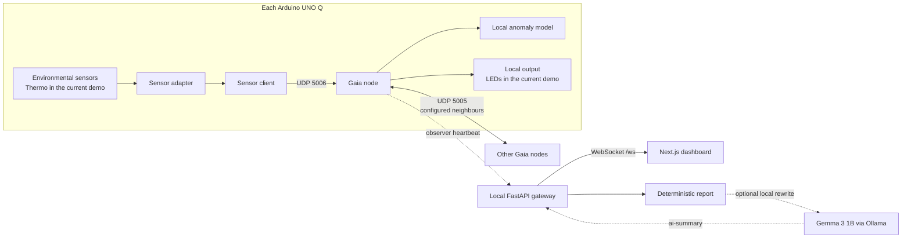

<p align="center">
  
</p>

<h1 align="center">Gaia</h1>

<p align="center">
  <strong>A distributed environmental intelligence platform that turns local sensor data into shared, resilient knowledge without requiring the cloud.</strong>
</p>

<p align="center">
  Modular sensing · Edge models · Aggregate computing · Federated statistics · Local Gemma 3 · Digital twins
</p>

> [!IMPORTANT]
> Gaia is an environmental technology platform. The current hackathon demonstrator uses Arduino UNO Q boards, temperature and humidity sensing, thermal-anomaly detection, and emergency guidance to prove the architecture. Fire is one reference use case, not the boundary of the project.

## Why Gaia exists

Environmental monitoring happens in places where connectivity, energy, and centralized infrastructure cannot always be assumed: farms, forests, protected areas, buildings, industrial sites, waterways, and remote communities. A centralized platform also creates delay and a single dependency between a physical event and the local response.

Gaia gives each node three capabilities: sense its surroundings, interpret its own data, and cooperate with nearby nodes. The network can recognize local changes, compare them with neighbouring conditions, build spatial gradients, reach consensus, and adapt when a node disappears. A gateway and dashboard can observe the field, but they do not own its critical behaviour.

The same distributed foundation can support different environmental profiles. Each profile combines sensors, a local model, shared fields, and a human-facing response.

## Environmental applications

Gaia is designed to grow beyond the thermal-hazard demonstrator.

| Application | Possible sensors | Collective behaviour |
| --- | --- | --- |
| Precision agriculture | Soil moisture, temperature, humidity, light, rainfall, pH | Irrigation zones, drought gradients, frost or heat-stress consensus |
| Air quality | CO₂, PM2.5/PM10, VOC, NO₂, ozone | Pollution-source localization, ventilation guidance, exposure maps |
| Forest and wildfire monitoring | Temperature, humidity, smoke, gas, wind | Early anomaly detection, hazard gradients, resilient alert propagation |
| Water and soil monitoring | pH, conductivity, turbidity, dissolved oxygen, soil chemistry | Contamination gradients, upstream/downstream comparison, local alerts |
| Ecosystem observation | Microclimate, acoustic, light, motion, species-specific sensors | Habitat changes, distributed event detection, long-term local baselines |
| Buildings and urban environments | CO₂, occupancy, noise, temperature, energy meters | Comfort and ventilation control, heat-island mapping, resource optimization |

These are platform directions, not features already validated by this repository. Each deployment needs the correct hardware, calibration data, model, field semantics, dashboard units, and domain validation.

## The current reference demonstrator

The repository proves the Gaia architecture with a thermal environmental scenario:

- Arduino UNO Q nodes read a Modulino Thermo;
- the edge model learns the local temperature baseline and rate of rise;
- neighbours exchange compact state and model statistics;
- the network derives a hazard gradient, consensus, and local guidance;
- LEDs expose the field without a browser;
- the dashboard renders live nodes plus simulated building and forest environments;
- a deterministic report, optionally rewritten by Gemma, explains the network state.

## What the prototype demonstrates

- **Local sensing and interpretation.** The current node learns a temperature baseline and detects changes from level and rate of rise.
- **Neighbour consensus.** Nodes compare local conditions before raising the stronger collective alert.
- **Distributed spatial fields.** Nodes propagate a distance value from an event source. The same primitive can represent heat, dryness, pollution, moisture, or another environmental quantity.
- **Local actuation and guidance.** LEDs and the matrix translate collective state into an immediate physical signal.
- **Self-healing behaviour.** The field recomputes when a node disappears and accepts it again when it returns.
- **Collaborative learning.** Nodes share compact model statistics instead of their stored dataset.
- **Human-readable reporting.** Deterministic facts remain available; a local language model can rewrite them for non-technical users.
- **Passive observation.** The digital twin visualizes the field without becoming its coordinator.

## System at a glance



The Wi-Fi network carries the current packets, but the **logical mesh is defined by `NEIGHBORS`**. Every device may hear a broadcast; a node only uses state from its configured neighbours. Gaia's environmental coordination layer is separate from the radio transport and could later move to another local network technology.

## End-to-end behaviour

1. A sensor adapter reads the local environment. The current sketch uses a Modulino Thermo and owns the LEDs.
2. The Python sensor client normalizes the measurement and sends it to `aggregate/node.py` over the local sensor bridge.
3. A local model converts the sensor stream into domain-specific state. The current model outputs a thermal anomaly score between `0` and `1`.
4. Once per second, neighbouring nodes exchange compact state used for gradient, consensus, and guidance calculations.
5. Every 15 seconds, a heartbeat also carries the learned model parameters for neighbour merging.
6. LEDs react to the state computed by the field, not to a hard-coded temperature threshold.
7. The gateway listens passively to the same UDP stream and publishes normalized snapshots to the browser.
8. The dashboard renders the physical field or a richer simulated building/forest digital twin.
9. A deterministic situation report is generated from network-owned facts; Gemma may rewrite it in plain language if available.

Closing steps 7–9 does not stop steps 1–6.

## Current implementation status

| Capability | Status | What is implemented |
| --- | --- | --- |
| Local sensing | Implemented reference profile | Thermo readings through Arduino Router Bridge; CSV recording; LED and matrix output |
| Multi-sensor profile system | Planned | Current schemas and UI still name temperature and humidity explicitly |
| Edge model | Implemented | Online mean/variance plus temperature rise; warm-up and contamination guard |
| Hazard gradient | Implemented | Distributed hop count with `via`; `99` means no known path |
| Consensus | Implemented | Threshold and hysteresis; default requires one agreeing neighbour |
| Self-healing | Implemented | Four-second neighbour timeout and automatic rejoin |
| Federated statistics | Implemented prototype | Full `mu`/`sigma`/`n` tuple exchanged every 15 seconds and pooled by sample count |
| Live dashboard | Implemented | Three manifest nodes mapped to `A-01`–`A-03` in `building-a` |
| Dashboard simulation | Implemented | 44-sensor building and 36-sensor forest, failures, hazards, obstructions, and routes |
| Gemma report | Optional | Local Ollama rewrite with deterministic fallback and multi-host failover |
| Live forest nodes | Not configured | `forest-north` is currently simulation-only |
| Automatic event propagation model | Not implemented | The fire simulation supports multiple sources and route recalculation, but propagation is operator-driven |
| Certified safety guidance | Out of scope | All route and escape output is prototype decision support |

## Quick start

### 1. Run the real node logic on one laptop

No Arduino or frontend is required. The simulator starts actual `aggregate/node.py` processes rather than imitating their output.

```bash
python3 aggregate/sim.py --list
python3 aggregate/sim.py --scenario consensus
python3 aggregate/sim.py --scenario failure
python3 aggregate/sim.py --scenario coldstart
```

Available scenarios include `nominal`, `alert`, `consensus`, `failure`, `rejoin`, `coldstart`, and `reroute`.

### 2. Open the dashboard in Simulation mode

```bash
cd dashboard
npm install
npm run dev
```

Open `http://localhost:3000`. Simulation mode is the default and requires no gateway. It provides:

- a four-floor building with 44 configured sensors;
- a forest with 36 configured sensors;
- temperature, fire, obstruction, node-failure, and network-failure controls;
- 3D mesh and hazard-gradient views;
- risk-first evacuation routing with automatic recalculation;
- desktop, tablet, mobile, light, and dark layouts.

These controls demonstrate the coordination engine through fire and evacuation scenarios. They do not restrict the underlying platform to that domain.

### 3. Rehearse the complete live data path without hardware

Use three terminals.

**Terminal 1 — gateway**

```bash
cd dashboard
python3 -m venv .venv
source .venv/bin/activate
pip install -r gateway/requirements.txt
uvicorn gateway.main:app --host 0.0.0.0 --port 8000
```

**Terminal 2 — frontend**

```bash
cd dashboard
cp .env.example .env.local
npm install
npm run dev
```

**Terminal 3 — actual node processes broadcasting to the gateway**

```bash
# boards off: with real boards on the air it refuses to start (FORCE=1 overrides)
python3 aggregate/sim.py --scenario consensus --broadcast --keep
```

Open `http://localhost:3000`, switch to **Live**, and select **Building A**. Stop the simulator before connecting physical boards so two processes do not compete for the same IDs.

For a bounded packet-only check, `dashboard/demo/fake_nodes.py` emits deterministic observer heartbeats but does not execute the distributed algorithms itself.

### 4. Add the optional local report

With the gateway running:

```bash
# Optional one-time model download
ollama pull gemma3:1b

# Gemma rewrite, with deterministic fallback
python3 gemma/report.py

# Or deterministic template only
NO_GEMMA=1 python3 gemma/report.py
```

The report process listens to gateway snapshots and publishes `ai-summary` events. Gemma only rewrites the already-computed result; it does not set `dist`, `alert`, or `escape_to`.

In the demo Gemma runs on the UNO Q boards themselves and `report.py` on the laptop asks the first board that answers: install, order of the boards and the memory settings are in [`gemma/README.md`](gemma/README.md).

### 5. Run the physical boards

Step by step, from the laptop's hotspot to the demo and what to do when something is off: [`START.md`](START.md). The complete UNO Q setup is documented in [`app_lab/echofield_node/README.md`](app_lab/echofield_node/README.md). Once the sketch and bridge are prepared, the three-node line is:

```bash
./app_lab/echofield_node/run_board.sh 1 2
./app_lab/echofield_node/run_board.sh 2 1,3
./app_lab/echofield_node/run_board.sh 3 2
```

For unattended demos, `install_service.sh` installs separate `gaia-node` and `gaia-sensor` systemd services with automatic restart.

## Rules of the current thermal-hazard demo

### One hot node is a gradient, not a consensus alert

With the default `AGREE_MIN=1`, a single hot node reports `dist = 0` and turns red, but `alert` stays false because no neighbour agrees. Heat two adjacent nodes—or run the `consensus` scenario—to demonstrate the general alarm truthfully.

### `dist = 99` does not mean “very safe”

It means **no path to a hazard is known**. A quiet field correctly reports `99` everywhere. Once another node reports a hazard, a node still at `99` may be disconnected from the information path and must not be selected as the safest destination.

In another Gaia profile, the same distance field could represent hops from a dry-soil region, a CO₂ hotspot, a pollution source, or a water-quality anomaly. The meaning, units, thresholds, and response belong to the selected environmental profile.

## UDP heartbeat contract

Every node normally emits one JSON datagram per second on UDP `5005`:

```json
{
  "id": 2,
  "anomaly": 0.12,
  "dist": 1,
  "via": 1,
  "alert": false,
  "escape_to": 3,
  "temperature": 23.8,
  "humidity": 46.2,
  "simulated": false,
  "mu": 22.4,
  "sigma": 1.1,
  "n": 120,
  "bytes_sent": 84,
  "bytes_if_raw_data": 960,
  "ts": 1731574800.2
}
```

| Field | Meaning |
| --- | --- |
| `id` | Physical node ID |
| `anomaly` | Local model score in `[0, 1]` |
| `dist` | Hop distance from the nearest known source; `0` source, `99` unknown |
| `via` | Neighbour from which the current gradient was learned |
| `alert` | Consensus result, with local threshold and neighbour agreement |
| `escape_to` | Available neighbour selected for local guidance |
| `temperature`, `humidity` | Latest readings for local observation; nullable |
| `simulated` | Distinguishes derived demo readings from measurements |
| `mu`, `sigma`, `n` | Optional model update, normally present every 15 seconds |
| `bytes_sent`, `bytes_if_raw_data` | Application-level comparison counters, not total radio traffic |
| `ts` | Source timestamp; gateway receipt time controls freshness |

Unknown fields are ignored. The gateway retains the last complete model tuple and counters when a heartbeat omits them.

> [!NOTE]
> Gaia does not upload a sensor dataset to a cloud service. The current demo does transmit the latest temperature and humidity on the **local LAN** for visualization, while collaborative learning exchanges compact statistics rather than stored raw history.

## Ports and services

| Port / socket | Owner | Purpose |
| --- | --- | --- |
| `/run/arduino-router.sock` | Arduino Router Bridge | MCU ↔ Python hardware calls |
| UDP `5006` | Sensor client and node | Reading request and node-state response |
| UDP `5005` | Nodes and gateway | Broadcast heartbeat / passive observation |
| UDP `5100 + id` | Laptop unicast mode | Per-node sensor bridge |
| UDP `5200 + id` | Laptop unicast mode | Per-node heartbeat transport |
| HTTP/WS `8000` | FastAPI gateway | Health, local integration APIs, `/ws` snapshots |
| HTTP `3000` | Next.js | Dashboard |
| HTTP `11434` | Ollama | Optional local Gemma inference |

## Algorithms

### Edge anomaly model

The model in `sensing_ml/model.py` is deliberately small and explainable:

```text
score = max(level_score, rate_score)

level_score = |temperature - mean| / max(sigma, 0.5 °C) / 4
rate_score  = positive temperature rise over 10 s / 1.5 °C
```

- The first 20 readings form the warm-up period.
- The model learns only while `score < 0.4`, preventing a hazard from becoming the new normal.
- Sample count is capped at 300 so the model continues adapting after merges.
- Humidity is recorded and displayed but is not currently an input to the score.

The included calibration recording contains 302 nominal samples and 70 heated samples. On that single indoor session, the maximum nominal score was `0.13` and the score crossed `0.7` about one second after heating began. This is a useful prototype result, not a wildfire benchmark.

### Federated parameter merge

Nodes pool mean and variance using neighbour `mu`, `sigma`, and `n`, weighted by sample count. This is a prototype of federated statistics: repeated merges can re-count already aggregated information, and the implementation does not yet use proximity weighting or delta sparsification.

### Aggregate field

- `dist`: distributed hop gradient, with split-horizon behaviour through `via`.
- `alert`: local threshold plus neighbour agreement, with `0.7` activation and `0.4` clearing thresholds by default.
- `escape_to`: neighbour-side guidance derived from the current field.
- timeouts: neighbours disappear from the table after four seconds without a heartbeat.

### Dashboard routing

Simulation mode uses a lexicographic Dijkstra search: minimize cumulative risk first, then distance. It removes blocked edges and hazardous vertices, supports multiple exits, and projects forest sensors onto the nearest reachable safe trail. This configured route graph is richer than the physical live field, where node-owned `escape_to` remains the authoritative guidance value.

## Extending Gaia with a new environmental profile

The current repository is not yet plug-and-play for arbitrary sensors. Temperature and humidity appear directly in the Python, UDP, TypeScript, telemetry, and simulation schemas. A clean extension should introduce a versioned profile contract instead of adding new top-level fields one by one.

1. **Define measurements.** Give every value a stable key, unit, valid range, precision, and missing-data rule, such as `co2_ppm`, `soil_moisture_pct`, or `pm25_ug_m3`.
2. **Add a hardware adapter.** Read the sensor without coupling the distributed node to a vendor library.
3. **Implement the local model.** Convert measurements into a normalized local state with documented calibration and confidence.
4. **Define collective semantics.** Decide what becomes a source, what neighbours exchange, how consensus works, and what the gradient means.
5. **Version the protocol.** Carry a profile ID and a measurement map while remaining compatible with older nodes.
6. **Configure the observer.** Add manifest metadata, labels, units, ranges, charts, map layers, and domain-specific reports.
7. **Validate the deployment.** Test sensors, calibration, failure states, false positives, privacy, and the action shown to users.

The detailed target architecture and missing refactors are documented in [`docs/ARCHITECTURE.md`](docs/ARCHITECTURE.md) and [`docs/IMPLEMENTATION_GAP_ANALYSIS.md`](docs/IMPLEMENTATION_GAP_ANALYSIS.md).

## Repository map

| Path | Responsibility |
| --- | --- |
| [`aggregate/`](aggregate/) | Distributed node loop, gradient, consensus, self-healing, guidance, diagnostics, and process-level scenarios |
| [`sensing_ml/`](sensing_ml/) | Online anomaly model, federated merge, calibration recordings, and synthetic checks |
| [`app_lab/echofield_node/`](app_lab/echofield_node/) | Arduino sketch, sensor/LED client, board launcher, bridge setup, and systemd installer |
| [`dashboard/`](dashboard/) | Next.js digital twin, simulation engine, live adapter, routing, components, and styles |
| [`dashboard/gateway/`](dashboard/gateway/) | UDP validation, manifest mapping, in-memory store, FastAPI, and WebSocket stream |
| [`dashboard/demo/`](dashboard/demo/) | Deterministic fake heartbeat generator for the dashboard contract |
| [`gemma/`](gemma/) | Deterministic situation report and optional local Gemma rewrite |
| [`docs/ARCHITECTURE.md`](docs/ARCHITECTURE.md) | Detailed component, data-flow, algorithm, and runtime documentation |
| [`docs/IMPLEMENTATION_GAP_ANALYSIS.md`](docs/IMPLEMENTATION_GAP_ANALYSIS.md) | Prioritized audit of missing, incorrect, promised, and production-readiness work |
| [`docs/HACKATHON_PRESENTATION.md`](docs/HACKATHON_PRESENTATION.md) | Slide structure, three-minute demo/video storyboard, claims, and Q&A material |
| [`network/`](network/) | Switching the boards between the laptop's hotspot and GaiaMesh, an ad-hoc network with no access point |
| [`video/`](video/) | Narration, subtitles and timeline for the demo video (`node video/build.mjs`, macOS) |
| [`START.md`](START.md) | Bringing the system up, the demo step by step, and troubleshooting |
| [`HANDOFF-linux.md`](HANDOFF-linux.md) | Moving the demo to GaiaMesh with the laptop on Linux |
| [`Plan.md`](Plan.md) | The hackathon delivery plan for Sunday |

## Verification

### Dashboard and gateway

```bash
cd dashboard
npm test
npm run typecheck
npm run build
python3 -m unittest discover -s gateway/tests -v
python3 -m unittest discover -s demo/tests -v
```

### Model and distributed scenarios

```bash
python3 sensing_ml/test_model.py
python3 sensing_ml/calibrate.py sensing_ml/normal.csv sensing_ml/hazard.csv
python3 aggregate/sim.py --scenario nominal
python3 aggregate/sim.py --scenario consensus
python3 aggregate/sim.py --scenario failure
python3 aggregate/sim.py --scenario rejoin
python3 aggregate/sim.py --scenario coldstart
# Platform-dependent today because gateway + nodes share UDP 5005,
# and it refuses while real boards are on the air (FORCE=1 overrides):
python3 aggregate/check_dashboard.py
```

The TypeScript suite covers domain logic, configuration, routing, simulation, reducer state, live protocol handling, scene models, terrain, telemetry models, and camera synchronization. Python tests cover the gateway protocol/store/listener/events and the fake sender. There are currently no browser E2E, WebGL snapshot, or automated physical-hardware tests.

## Configuration

The most important node variables are `NODE_ID`, `NEIGHBORS`, `PEERS`, `MODE`, `ANOMALY_SRC`, `AGREE_MIN`, `TIMEOUT`, `HEARTBEAT`, `PARAM_EVERY`, `SENSOR_PORT`, and `SENSOR_TTL`. Their defaults and failure-recovery instructions are documented in [`aggregate/README.md`](aggregate/README.md).

The dashboard uses `NEXT_PUBLIC_GAIA_GATEWAY_URL`, defaulting to `ws://localhost:8000/ws`. Gateway settings include `GAIA_UDP_HOST`, `GAIA_UDP_PORT`, `GAIA_OFFLINE_AFTER_SECONDS`, `GAIA_NODE_MANIFEST`, and `GAIA_ALLOWED_ORIGINS`; see [`dashboard/gateway/README.md`](dashboard/gateway/README.md).

## Security, privacy, and deployment boundary

Gaia is designed for a trusted local demo network. The current UDP channels and gateway APIs do not provide authentication, encryption, anti-replay protection, authorization, TLS, or rate limiting. A device on the same LAN could observe or forge packets. Do not expose the gateway directly to the public internet.

The gateway and model are in-memory. Restarting them clears live state; the node can relearn locally or acquire neighbour parameters in a later merge. The sensor client appends to `readings.csv` without rotation, so a long-running deployment needs storage management.

## Known prototype limits

- The platform vision is multi-domain, but the current protocol, model, dashboard types, and simulations still contain temperature, humidity, hazard, fire, and evacuation concepts directly. The environmental profile abstraction is designed in the documentation but not yet implemented.
- The sketch and the Bridge were validated on our three UNO Q boards (core `arduino:zephyr` 1.1.0, Arduino_Modulino with its dependencies); other firmware or library versions are untested.
- Live mode is configured for three building nodes; the forest remains simulation-only.
- The model uses temperature only and was calibrated on one short indoor recording, not a wildfire dataset.
- Federated merging is sample-weighted but can double-count statistics across repeated exchanges.
- `bytes_sent` compares JSON model parameters with hypothetical raw-reading JSON; it is not a full energy or network measurement, and the current dashboard does not display these counters.
- The physical `escape_to` field is node-to-node guidance; building/forest exit routing is a dashboard simulation feature.
- The live gateway is an observer, but its unauthenticated local POST endpoints can inject display events.
- The code is under the MIT license ([`LICENSE`](LICENSE)); Gemma 3 is a separate model under Google's Gemma terms and is not redistributed here.

For the technical boundaries see [`docs/ARCHITECTURE.md`](docs/ARCHITECTURE.md). For a prioritized list of missing, incorrect, or promised work and a concrete implementation path for each item, see [`docs/IMPLEMENTATION_GAP_ANALYSIS.md`](docs/IMPLEMENTATION_GAP_ANALYSIS.md).

## Team

Gaia was developed for an Arduino/Junction hackathon by:

- **Giuliano** — aggregate computing, distributed node behaviour, networking, and diagnostics;
- **Chuqi** — edge anomaly model, calibration, federated statistics, hardware sensing, and Gemma reporting;
- **Pietro** — dashboard, digital twin, demo integration, and presentation.

## Presentation material

The repository includes a presentation-ready narrative, slide outline, three-minute video storyboard, demo sequence, verified metrics, and wording to avoid overclaiming in [`docs/HACKATHON_PRESENTATION.md`](docs/HACKATHON_PRESENTATION.md).
