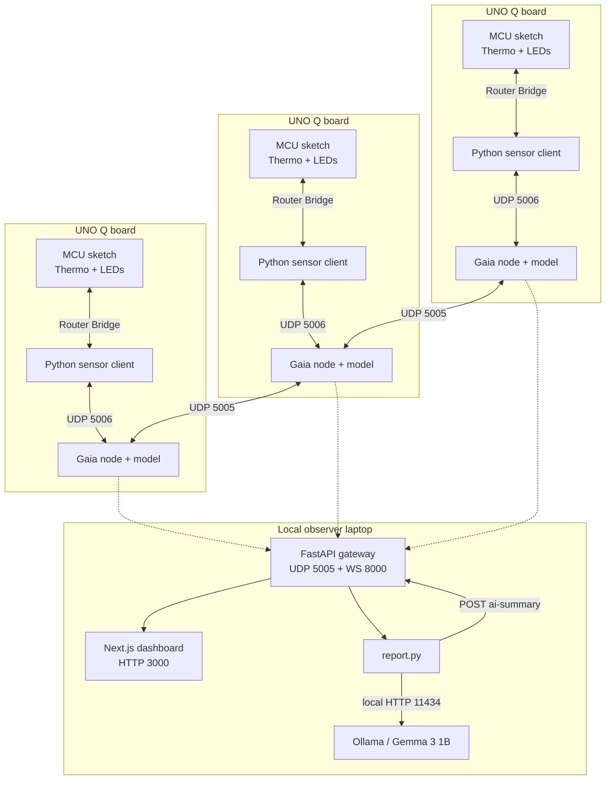
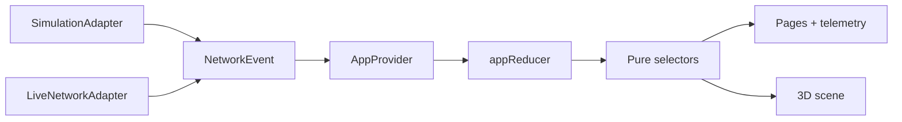

# Gaia Architecture and Technical Documentation

This document describes Gaia as an environmental technology platform and maps that vision to the current working tree. The repository contains one reference profile centered on temperature, thermal anomalies, hazard fields, and emergency guidance. The same distributed architecture can support agriculture, air quality, water, soil, biodiversity, and urban sensing after the profile and measurement layers become configurable.

## 1. Architectural principles

Gaia is built around five decisions:

1. **The environmental field is autonomous.** Sensor acquisition, local interpretation, neighbour exchange, gradients, consensus, and local outputs work without the dashboard.
2. **The gateway is an observer.** It normalizes packets for browsers but does not send control state back to the mesh.
3. **Local rules are explainable.** Each environmental profile should define measurable inputs, local interpretation, collective rules, and outputs that can be inspected.
4. **Simulation and live data share a frontend contract.** Both adapters emit normalized `NetworkEvent` values into the same React state tree.
5. **Language generation is downstream.** The deterministic field state exists first; Gemma is an optional plain-language renderer.

## 2. Platform model and current profile

Gaia separates five responsibilities conceptually:

| Layer | Platform responsibility | Current implementation |
| --- | --- | --- |
| Measurement | Read and normalize environmental values | Modulino Thermo; `temp` and `hum` |
| Local intelligence | Learn local conditions and derive compact state | Temperature baseline and rate-of-rise anomaly |
| Collective intelligence | Exchange state and compute spatial/network behaviour | Hazard gradient, neighbour consensus, `escape_to` |
| Local response | Act without waiting for a server | RGB LEDs and LED-matrix direction |
| Observation and explanation | Visualize, store, and explain field state | Gateway, digital twin, deterministic report, optional Gemma |

The first four layers form the reusable Gaia concept. The concrete measurements and collective meaning should come from an environmental profile. A future agriculture profile might exchange drought stress and irrigation need. An air-quality profile might propagate CO₂ or particulate hotspots and ventilation guidance. A water profile could compare upstream and downstream anomalies.

The code does not yet implement that profile abstraction. Temperature, humidity, anomaly, hazard, fire, and evacuation concepts appear directly across Python and TypeScript types. Section 15 defines the refactor needed to make the vision operational.

## 3. Runtime topology



The default physical topology is a line: `1 ↔ 2 ↔ 3`. `NEIGHBORS` defines which received IDs influence a node. `PEERS` can replace broadcast destinations when a hotspot isolates clients.

## 4. Hardware layer

### MCU sketch

File: `app_lab/echofield_node/sketch/sketch.ino`

Responsibilities:

- initialize Modulino Thermo, optional Modulino Pixels, onboard RGB LEDs, and LED matrix;
- expose `read_temp`, `read_hum`, `set_pixels`, and `show_state` through Arduino Router Bridge;
- render a quiet marker, failure cross, moving direction arrows, or hazard animation.

The MCU owns the hardware so Python never competes with another sketch for the same devices. Exact Router Bridge symbols, LED pin names, and library APIs remain dependent on the installed UNO Q toolchain and should be validated on the demo boards.

### Sensor and LED client

File: `app_lab/echofield_node/python/main.py`

Once per second it:

1. calls the MCU for temperature and humidity;
2. appends `time,temp,hum` to a CSV file;
3. sends the reading to the local node over UDP;
4. receives `id`, `anomaly`, `dist`, `via`, `alert`, and `escape_to`;
5. maps field state to LEDs and the matrix.

It detects whether it is inside the App Lab container. In the container, it discovers the board-host address from the default route; on the board OS it uses `127.0.0.1`. `NODE_HOST` overrides discovery.

LED mapping:

| State | Colour / display |
| --- | --- |
| Node process not answering | Dim white and matrix cross |
| Hazard here or alert | Red |
| One hop from hazard | Amber |
| More than one known hop | Green |
| No hazard known (`99`) | Blue / quiet marker |

### Board lifecycle

- `setup_bridge.sh` extracts `arduino.app_utils` from the local App Lab image.
- `run_board.sh` starts the node and sensor client together for manual work.
- `install_service.sh` creates separate `gaia-node` and `gaia-sensor` systemd services.

Separating the services prevents a Bridge failure from stopping mesh communication. Both restart automatically in the installed configuration.

## 5. Distributed node

File: `aggregate/node.py`

The same program runs on every node. Its concurrent loops are:

| Loop | Responsibility |
| --- | --- |
| Sensor bridge | Receive readings and return current field state |
| Send | Broadcast heartbeat approximately once per second |
| Receive | Keep last state and model tuple from configured neighbours |
| Update | Recompute anomaly, gradient, consensus, and escape direction |
| Parameter merge | Pool neighbour model statistics every 15 seconds |
| Keyboard | Allow local demo anomaly control |

Shared state is partly protected by a lock. The model object itself is accessed from multiple threads without its own lock, which is acceptable for a demo but requires synchronization in a production implementation.

### Gradient

- A node whose anomaly exceeds `ALERT_ON` becomes a source with `dist = 0`.
- Other nodes select the lowest valid neighbour distance and add one.
- `via` records the selected neighbour and avoids immediate two-node feedback.
- If no source path is known, the node reports `99`.
- Neighbours not heard within `TIMEOUT` are removed before recomputation.

The split-horizon rule addresses the simplest loop, but it is not a full routing protocol and does not prove loop-free convergence on arbitrary cyclic topologies.

### Consensus and hysteresis

Default thresholds:

- activation: local anomaly at least `0.7` and at least one agreeing neighbour;
- clearing: anomaly below `0.4` and no neighbour remains in anomaly.

This makes the visible gradient responsive to a single source while reserving the stronger `alert` flag for agreement.

### Escape guidance

`escape_to` is intended as local neighbour guidance. It is separate from the dashboard's configured route graph and should not be presented as a certified building exit calculation.

Current code chooses the greatest neighbour distance, and therefore needs additional treatment for the sentinel `99` before it can be considered robust safety logic. The same caveat applies to the standalone Gemma template.

### Network diagnostics

- `aggregate/listen.py`: passive packet printer;
- `aggregate/netcheck.py`: interface, broadcast, peer, and packet diagnosis;
- `aggregate/check_dashboard.py`: feeds real node packets through gateway parsing/store logic;
- `aggregate/sim.py`: process-level scenarios using real node processes.

`aggregate/sim.py` is the authoritative laptop rehearsal for distributed behaviour. `dashboard/demo/fake_nodes.py` is a contract generator and does not execute the algorithms.

## 6. Edge model

File: `sensing_ml/model.py`

### State

- `n`: learned sample count, capped at 300;
- `mu`: online temperature mean;
- `var` / `sigma`: online variance and standard deviation;
- recent `(time, temperature)` values for the rate feature;
- application-level byte counters.

### Scoring

The level component becomes active after 20 readings:

```text
level = min(1, abs(temp - mu) / max(sigma, 0.5) / 4)
```

The rate component uses only positive rise across the recent ten-second window:

```text
rate = clamp((temp_now - temp_window_start) / 1.5, 0, 1)
```

The final score is `max(level, rate)`. The model updates its baseline only below `0.4`. Humidity is carried through the system but does not currently affect scoring.

### Parameter sharing

`get_params(share=True)` returns `mu`, `sigma`, and `n` and increments the model-byte counter. `merge_params` calculates a pooled mean and variance weighted by `n`.

This is compact federated statistics, with two known research limitations:

- values already merged can be counted again in later rounds;
- sample count, rather than physical proximity or trust, controls weight.

### Calibration evidence

- `normal.csv`: 302 samples over about five minutes;
- `hazard.csv`: 70 samples with a heat rise beginning around sample 11;
- recorded maximum nominal score: `0.13`;
- recorded threshold crossing: about one second after heating begins.

The recordings establish demo calibration for one indoor sensor session. They do not establish wildfire accuracy, generalization, sensitivity, or false-positive rates across environments.

## 7. Heartbeat and bridge contracts

### Sensor bridge

Request:

```json
{"temp": 23.4, "hum": 41.0}
```

Response:

```json
{"id": 1, "anomaly": 0.91, "dist": 0, "via": null, "alert": false, "escape_to": 2}
```

### Node heartbeat

Required by the gateway:

- `id`: non-negative integer;
- `anomaly`: finite number from 0 to 1;
- `dist`: non-negative integer;
- `alert`: boolean;
- `temperature`, `humidity`: finite numbers or `null`;
- `ts`: finite number.

Optional:

- `via`, `escape_to`;
- `simulated`;
- complete `mu`, `sigma`, `n` tuple;
- `bytes_sent`, `bytes_if_raw_data`;
- additional node-only fields such as `boot`.

The gateway ignores unknown fields and rejects malformed required values. A partial model tuple is ignored while the rest of the heartbeat remains usable.

## 8. Gateway

Directory: `dashboard/gateway/`

### Components

- `protocol.py`: packet validation and manifest loading;
- `udp_listener.py`: background UDP socket and safe datagram processing;
- `store.py`: in-memory normalized state, deduplication, sticky fields, topology, and timeouts;
- `events.py`: packet-to-snapshot bridge;
- `main.py`: FastAPI lifespan, HTTP APIs, WebSocket clients, and broadcast;
- `node_manifest.json`: physical ID → environment sensor mapping.

### Normalization

The current manifest maps physical nodes `1`, `2`, `3` to `A-01`, `A-02`, `A-03` in `building-a`. The gateway adds names, 3D positions, configured neighbours, receipt time, connectivity, and presentation status.

Duplicate packets from multiple network interfaces are suppressed by `(node_id, source_timestamp)`. Model parameters and counters are sticky because most heartbeats omit them. Node freshness is based on gateway receipt time rather than source time, permitting a rebooted node with a reset clock to rejoin.

### APIs

| Method | Path | Behaviour |
| --- | --- | --- |
| `GET` | `/health` | Process liveness only |
| `POST` | `/v1/environments/{environment_id}/nodes/{node_id}` | Inject/update an observer sensor record |
| `POST` | `/v1/events` | Broadcast an arbitrary local event |
| WebSocket | `/ws` | Initial snapshot and subsequent events/snapshots |

The store is in memory. `ai-summary` events are broadcast rather than persisted, so a newly connected client may need the report process to publish again.

## 9. Dashboard

Directory: `dashboard/`

### Stack

- Next.js 16 App Router;
- React 19 and TypeScript;
- React Three Fiber, Drei, and Three.js;
- global CSS variables and responsive styles;
- Node's built-in test runner.

### State flow



Switching mode destroys the old adapter and creates the other. Simulation starts with deterministic complete environments. Live mode clears simulation-only facts, keeps only whitelisted physical IDs, and waits for gateway packets.

### Configured environments

| Environment | Sensors | Geometry / graph |
| --- | ---: | --- |
| Building A | 44 | Four floors, 24 rooms, 2 exits, 70 waypoints, 72 route edges |
| Forest North | 36 | Procedural terrain, 4 exits, 11 waypoints, 16 route edges |

Only Building A currently has live sensor IDs. Forest North is available in simulation.

### Views

- **Overview:** 3D environment, telemetry, hazard gradient, simulation controls, route, and report.
- **Live field:** physical graph without geographic staging; authoritative `dist` and link state.
- **Environments:** status cards and 3D previews.
- **Sensor Logs:** normalized reading table, simulation activity, and alert list.

These are reducer states rather than separate URLs.

### Simulation engine

The engine supports temperature increase, confirmed fire, blocked route edge, node disable/enable, network failure, and reset. It recomputes topology and consensus from the same domain model used by the UI.

### Routing

The pathfinder uses a priority queue and compares candidates lexicographically by cumulative risk and then distance. Blocked edges and hazardous target vertices are excluded.

Forest routing adds two geometric rules:

- attach the selected sensor to the nearest reachable trail segment;
- reject path segments intersecting an active fire circle, except movement outward when the origin is already inside the circle.

### 3D rendering

- Building and forest geometry is procedural and local.
- Sensors, links, hazards, and evacuation routes share domain state.
- Heavy canvases are dynamically imported with server-side rendering disabled.
- Device pixel ratio is capped; trees and fire particles use instancing.
- The dedicated gradient scene renders on demand.

The main scene still has meaningful GPU cost because it renders continuously with shadows. The Environments view mounts two previews simultaneously.

### Accessibility and responsive behaviour

Implemented measures include semantic landmarks, real buttons/selects, visible focus, table headers/caption, ARIA state attributes, live status regions, reduced-motion handling, non-WebGL controls for gradient sensors, mobile panel tabs, and touch-size adjustments.

Known gaps:

- the custom Settings dialog lacks a full focus trap and background inert handling;
- SVG graph nodes respond to Enter but not Space;
- direct 3D picking is pointer-first, with an accessible sensor-list alternative elsewhere.

### SEO boundary

The app defines an English document language, title, description, and H1 per view. It has no canonical, social metadata, sitemap, structured data, or URL routes for individual views. That is reasonable for a local operational dashboard, but a public marketing deployment would need a separate SEO layer.

## 10. Situation reporting and Gemma

File: `gemma/report.py`

Runtime behaviour:

1. connect to gateway `/ws`;
2. wait for a changed field state;
3. publish a deterministic template immediately;
4. optionally ask the first responding Ollama host to rewrite it;
5. discard the rewrite if the field changed during generation;
6. publish the Gemma line as `ai-summary`.

The dashboard also builds its own deterministic live situation report from finite distances, offline nodes, and `escape_to`.

Gemma does not receive a time-series trend or calculate a route. It should be described as a local communication layer, not an emergency decision-maker.

## 11. Data ownership and failure behaviour

| Failure | Expected result |
| --- | --- |
| Browser closes | Nodes, model, LEDs, gradient, and consensus continue |
| Gateway stops | Nodes continue; browser live stream disconnects |
| Gemma/Ollama stops | Deterministic report remains available |
| Sensor client stops | Mesh process continues; reading becomes stale and may fall back to simulated input depending on settings |
| Node disappears | Neighbours remove it after timeout and recompute |
| Node reboots | Model restarts; node can warm up or merge neighbour statistics |
| Hotspot blocks broadcast | Configure explicit `PEERS` addresses |
| Frontend WebSocket drops | Last snapshot remains; reconnect uses capped exponential backoff |

## 12. Persistence

- Sensor samples: appended to CSV on the board, without rotation.
- Node model and neighbour table: memory only.
- Gateway snapshot and deduplication history: memory only.
- Dashboard state: memory, except theme preference in `localStorage`.
- Board ID and neighbours: systemd environment file when services are installed.

## 13. Security boundary

The prototype assumes a trusted demo LAN.

- UDP packets are unsigned, unencrypted, and replayable.
- The sensor bridge binds to the network and does not authenticate the client.
- Gateway POST and WebSocket endpoints have no authentication or authorization.
- CORS limits browsers but is not access control.
- `/v1/events` accepts an arbitrary object for local integrations.
- There is no TLS, rate limiting, device identity, or audit log.

Production hardening would require device credentials, signed messages, replay protection, schema validation at every boundary, authenticated WebSockets/APIs, TLS, least-privilege network binding, durable state policy, and operational monitoring.

## 14. Verification map

| Area | Current verification |
| --- | --- |
| Frontend domain and state | 108 Node test cases in the current working tree |
| Type system | `tsc --noEmit` |
| Gateway | 24 Python unit tests |
| Fake sender | 4 Python unit tests |
| Distributed behaviour | Executable `aggregate/sim.py` scenarios with verdicts |
| Model | Deterministic console checks and calibration replay; not assertion-based |
| Browser/WebGL | Manual only |
| Physical boards and Wi-Fi | Manual only |
| Gemma/Ollama | Manual only |

## 15. Source-of-truth notes

- `Plan.md`, handoff files, and `dashboard/docs/superpowers/` describe planning history and may not match the current working tree.
- Current code and tests are authoritative for counts, IDs, ports, and implemented behaviour.
- The correct laptop unicast heartbeat port is `5200 + NODE_ID`, not `5000 + NODE_ID`.
- The current live manifest contains three nodes, despite older dashboard documentation describing two.
- The Green AI counters remain in the protocol but are not currently rendered by the dashboard.

## 16. Environmental profile architecture

Gaia needs a versioned profile layer before teams can add CO₂, soil, water, acoustic, or other sensors cleanly.

### Profile definition

A profile should declare:

- `profileId` and schema version;
- measurement keys, units, valid ranges, precision, and privacy class;
- local model name, parameters, warm-up, and output fields;
- shared state and federated parameter schema;
- source, gradient, consensus, and recovery semantics;
- local actuator mapping;
- dashboard labels, charts, colors, summaries, and alerts.

### Protocol shape

The fixed `temperature` and `humidity` fields can remain during migration, but new profiles should use a typed measurement map:

```json
{
  "schema": "gaia.node.v2",
  "profile": "air-quality.co2",
  "node": { "id": 2, "boot": "a91f", "sequence": 1842 },
  "measurements": {
    "co2_ppm": { "value": 1180, "unit": "ppm", "quality": "measured" },
    "temperature_c": { "value": 23.8, "unit": "Cel", "quality": "measured" }
  },
  "state": {
    "score": 0.72,
    "source": true,
    "fieldDistance": 0,
    "consensus": "confirmed"
  }
}
```

Use a registry or discriminated union for known measurement types. Do not accept arbitrary units or unlimited maps at runtime. Gateway and frontend validators must reject unsupported profile versions while retaining the last valid state.

### Model interface

Replace direct imports of one global temperature model with a profile interface:

```text
ProfileModel.score(measurements, timestamp) -> LocalState
ProfileModel.exportUpdate() -> VersionedModelUpdate | null
ProfileModel.merge(updates) -> MergeResult
ProfileModel.snapshot() / restore(snapshot)
```

The distributed node should depend on `LocalState` and field semantics, not on `temp`, `mu`, or `sigma`. Profiles may still use those values internally.

### Observer interface

The dashboard should render measurements from metadata rather than fixed temperature cards. A profile supplies compact presentation rules, while core components handle status, freshness, topology, comparison, and accessibility. Domain-specific views can extend the generic telemetry layer without changing the transport adapter.

### Example profiles

| Profile | Local state | Shared field | Possible response |
| --- | --- | --- | --- |
| Agriculture / soil | Water stress score | Distance from dry region | Irrigation priority |
| Air quality / CO₂ | Exposure or ventilation score | Distance from concentration source | Ventilation or occupancy guidance |
| Water quality | Multivariate contamination score | Upstream/downstream anomaly field | Sampling and isolation priority |
| Forest microclimate | Heat, dryness, smoke confidence | Environmental risk field | Alert propagation and local guidance |
| Urban heat | Thermal discomfort index | Heat-island gradient | Cooling-resource placement |

Every profile needs domain data and validation. Reusing Gaia's network architecture does not validate the profile's scientific model automatically.

## 17. Production-oriented next steps

1. Introduce the versioned environmental profile, measurement, local-state, and presentation contracts.
2. Validate and lock the exact UNO Q hardware APIs and create a repeatable hardware acceptance test.
3. Correct sentinel-`99` handling in all escape/report paths.
4. Add message authentication and stricter schema validation before expanding beyond a trusted LAN.
5. Persist or explicitly version model state and stop double-counting federated aggregates.
6. Rotate sensor recordings and add health telemetry for the sensor process itself.
7. Build separate, representative datasets and validation plans for every environmental profile.
8. Add browser E2E, accessibility automation, WebSocket lifecycle tests, and a physical demo checklist.
9. Reconcile older two-node documentation with the current three-node manifest.
10. Add a license, third-party notices, dataset provenance, and model licensing notes.
11. Keep network-owned state, domain-specific decisions, and dashboard simulations visually distinct.
